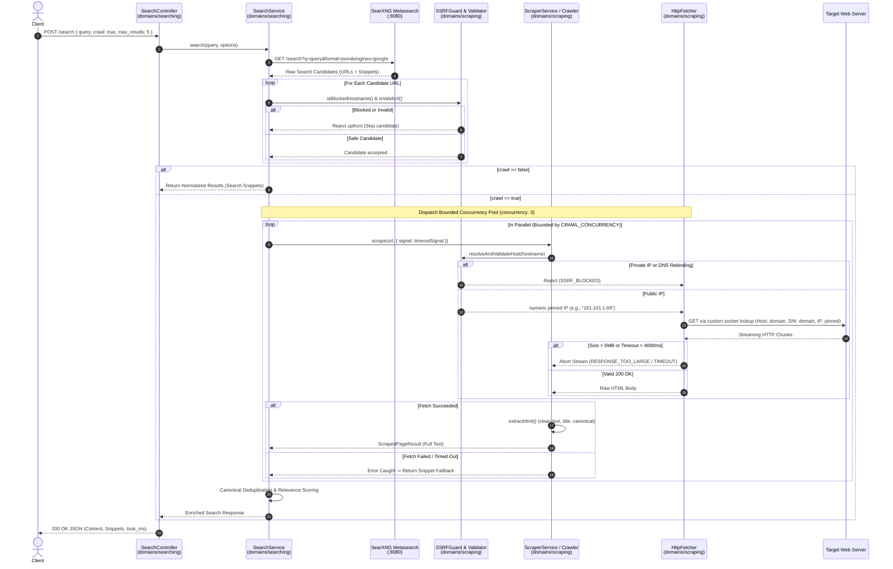

# Crawling & Scraping Engine: Architecture, Implementation, and Developer Guide

This document is the authoritative engineering guide for the web crawling, single-page scraping, HTML extraction, and benchmarking implementation in `@tavily/scraping` (located in [`domains/scraping`](../)) and its integration with the search engine in `@tavily/searching` (located in [`domains/searching`](../../searching)).

---

## Table of Contents

1. [Overview & Terminology](#1-overview--terminology)
2. [Architecture & Request Lifecycle](#2-architecture--request-lifecycle)
3. [Step-by-Step: Using the Features](#3-step-by-step-using-the-features)
4. [Configuration Reference](#4-configuration-reference)
5. [Security & Error Handling Safeguards](#5-security--error-handling-safeguards)
6. [Testing Guide](#6-testing-guide)
7. [Benchmarking & Performance Harness](#7-benchmarking--performance-harness)
8. [End-to-End Verification Walkthrough](#8-end-to-end-verification-walkthrough)
9. [PR Review Checklist & Suggested Review Order](#9-pr-review-checklist--suggested-review-order)
10. [Known Limitations & Future Improvements](#10-known-limitations--future-improvements)

---

## 1. Overview & Terminology

The Tavily monorepo search and crawling pipeline processes information in four distinct, decoupled stages:

```
┌──────────────────────────────────────────────────────────────────────────────────┐
│                             SEARCH & CRAWLING LIFECYCLE                          │
└──────────────────────────────────────────────────────────────────────────────────┘
   [Stage 1: Search]       Upstream search queries via SearXNG metasearch (Google)
          │                ↳ Produces raw candidate URLs, search titles, snippets
          ▼
   [Stage 2: Validation]   Upfront URL syntax check, protocol filtering, and SSRF guard
          │                ↳ Drops malformed URLs, localhost, RFC 1918 private IPs
          ▼
   [Stage 3: Fetching]     High-throughput streaming HTTP/HTTPS client with DNS pinning
          │                ↳ Downloads raw HTML chunks up to size ceiling (5 MB)
          ▼
   [Stage 4: Extraction]   Zero-dependency HTML sanitizer and semantic textifier
                           ↳ Strips scripts, styles, boilerplate (nav/footer/ads)
                           ↳ Extracts clean body text, titles, descriptions, links
```

### Core Terminology:

| Term                            | Technical Definition                                                                                                                                                                                                           | Where Implemented                                   |
| ------------------------------- | ------------------------------------------------------------------------------------------------------------------------------------------------------------------------------------------------------------------------------ | --------------------------------------------------- |
| **URL Discovery**               | Querying the upstream search provider (SearXNG) or parsing hyperlinks (`<a href>`) on an already-crawled page to find candidate destinations.                                                                                  | `SearxngClient.search()` / `CrawlerService.crawl()` |
| **Search Result**               | Metadata returned by upstream search engine: destination URL, page title, relevance score, and a ~150-character search snippet.                                                                                                | `domains/searching/src/services/search.service.ts`  |
| **Single-Page Scraping**        | Direct HTTP retrieval of a single target URL followed by content extraction and metadata parsing.                                                                                                                              | `ScraperService.scrape()`                           |
| **Multi-Page Crawling**         | Autonomous Breadth-First Search (BFS) graph traversal originating at a `seedUrl`, traversing up to `maxDepth` and `maxPages` within domain boundaries.                                                                         | `CrawlerService.crawl()`                            |
| **Readable Content Extraction** | Transforming raw HTML document markup into clean, un-rendered plain text suitable for LLMs, stripping navigation chrome, scripts, and styling.                                                                                 | `extractHtml()` in `html-extractor.ts`              |
| **Snippet Fallback**            | Resilient degradation: if fetching or extraction fails (404, 500, timeout, or size overflow), the system preserves the search response by populating `content` with the ~150-char upstream search snippet instead of crashing. | `SearchService.search()`                            |

### HTTP-Based Scraping vs. Browser-Based Crawling

> [!IMPORTANT]
> **No Headless Browser is Used in Production.**  
> `@tavily/scraping` intentionally uses a high-performance streaming Node.js `http`/`https` transport (`HttpFetcher`) rather than Puppeteer, Playwright, or Chromium.

#### Technical Implications:

- **Zero JavaScript Execution**: The engine downloads raw server-side HTML. Client-side Single Page Applications (SPAs) built with React, Vue, or Angular that render content purely via client-side JavaScript bundles will yield only the static initial HTML container (typically under 50 words) unless the origin employs Server-Side Rendering (SSR).
- **Extreme Speed & Efficiency**: Eliminates browser process initialization costs (typically 500–1,500 ms per Chromium instance) and keeps memory overhead below ~15 MB per concurrent worker.
- **Bypass of Heavy Bot Sandboxes**: Lightweight HTTP requests with standard browser headers are processed by edge CDNs with lower latency than headless browser launches.

---

## 2. Architecture & Request Lifecycle

### Request Lifecycle Diagram



### Module Responsibilities & Source Map

| Module                | Exact Path                                                                                                                                   | Core Responsibility                                                                                                                                                                                           |
| --------------------- | -------------------------------------------------------------------------------------------------------------------------------------------- | ------------------------------------------------------------------------------------------------------------------------------------------------------------------------------------------------------------- |
| **`HttpFetcher`**     | [`domains/scraping/src/clients/http-fetcher.ts`](file:///d:/Tavily-REPO/tavily/domains/scraping/src/clients/http-fetcher.ts)                 | Low-level HTTP/HTTPS streaming client. Enforces DNS pinning (`createPinnedLookup`), TLS SNI preservation, redirect tracking (up to 5), 5 MB streaming size limits, and `AbortSignal` timeouts.                |
| **`ssrf-guard`**      | [`domains/scraping/src/utils/ssrf-guard.ts`](file:///d:/Tavily-REPO/tavily/domains/scraping/src/utils/ssrf-guard.ts)                         | Security engine. Validates IPv4 (RFC 1122, 1918, 3927, 6598, 6890), IPv6 (RFC 4193, 4291, 6052), cloud metadata (`169.254.169.254`), and multi-address DNS resolution anti-round-robin protection.            |
| **`url-validator`**   | [`domains/scraping/src/utils/url-validator.ts`](file:///d:/Tavily-REPO/tavily/domains/scraping/src/utils/url-validator.ts)                   | Normalizes URLs, strips fragments, lowercases protocols/hosts, and re-validates relative/absolute redirect targets.                                                                                           |
| **`html-extractor`**  | [`domains/scraping/src/utils/html-extractor.ts`](file:///d:/Tavily-REPO/tavily/domains/scraping/src/utils/html-extractor.ts)                 | Zero-dependency streaming regex parser. Strips `<script>`, `<style>`, `<nav>`, `<footer>`, `<header>`, `<aside>`, ads, and comments. Decodes entities and extracts titles, descriptions, and canonical links. |
| **`RobotsPolicy`**    | [`domains/scraping/src/utils/robots-parser.ts`](file:///d:/Tavily-REPO/tavily/domains/scraping/src/utils/robots-parser.ts)                   | RFC 9309-compliant robots.txt parser with longest-match precedence and `Crawl-delay` politeness enforcement.                                                                                                  |
| **`ScraperService`**  | [`domains/scraping/src/services/scraper.service.ts`](file:///d:/Tavily-REPO/tavily/domains/scraping/src/services/scraper.service.ts)         | High-level facade for single-page scraping combining `HttpFetcher` with `html-extractor`.                                                                                                                     |
| **`CrawlerService`**  | [`domains/scraping/src/services/crawler.service.ts`](file:///d:/Tavily-REPO/tavily/domains/scraping/src/services/crawler.service.ts)         | Multi-page BFS traversal engine. Coordinates queue bounds (`maxQueueSize: 1000`), per-origin rate limiting locks (`OriginRateLimiter`), depth constraints, and link deduplication.                            |
| **`CrawlController`** | [`domains/scraping/src/controllers/crawl.controller.ts`](file:///d:/Tavily-REPO/tavily/domains/scraping/src/controllers/crawl.controller.ts) | Express HTTP controller exposing the standalone `POST /crawl` endpoint with Zod schema validation and bounds clamping.                                                                                        |
| **`SearchService`**   | [`domains/searching/src/services/search.service.ts`](file:///d:/Tavily-REPO/tavily/domains/searching/src/services/search.service.ts)         | Search orchestrator. Queries SearXNG, validates candidates, coordinates worker pool concurrency (`runWithBoundedConcurrency`), handles fallback snippets, and deduplicates canonical URLs.                    |

---

## 3. Step-by-Step: Using the Features

### 1. Prerequisites & Installation

Ensure Node.js `>=20.0.0` and `pnpm` are installed:

```powershell
# From the repository root:
pnpm install
```

### 2. Start Upstream Search Provider (SearXNG)

The search service requires SearXNG running in Docker on port `8080`:

```powershell
docker compose -f ./infrastructure/local/searching/docker/docker-compose.yml -f ./infrastructure/local/searching/docker/docker-compose.override.yml up -d
```

Verify SearXNG is reachable:

```powershell
Invoke-RestMethod -Uri "http://localhost:8080/healthz"
# Expected response: "OK"
```

### 3. Start the Searching API Server

```powershell
pnpm --filter @tavily/searching dev
```

The search service will bind to port `3000`. Verify health:

```powershell
Invoke-RestMethod -Uri "http://localhost:3000/health"
# Returns: {"status":"ok"}
```

### 4. Sending Search & Crawl Requests

#### A. Search with Crawling Enabled (`crawl: true`)

Fetches top candidate webpages, extracts their readable text, and enriches the response:

```powershell
$body = @{
    query = "artificial intelligence"
    crawl = $true
    max_results = 3
    include_raw_content = $true
} | ConvertTo-Json

Invoke-RestMethod -Uri "http://localhost:3000/search" -Method Post -Body $body -ContentType "application/json"
```

_Equivalent cURL Command:_

```bash
curl -X POST http://localhost:3000/search \
  -H "Content-Type: application/json" \
  -d '{"query":"artificial intelligence","crawl":true,"max_results":3}'
```

#### B. Search with Crawling Disabled (`crawl: false`)

Returns fast upstream search metadata and snippets without making outbound crawl requests:

```powershell
$body = @{
    query = "artificial intelligence"
    crawl = $false
    max_results = 3
} | ConvertTo-Json

Invoke-RestMethod -Uri "http://localhost:3000/search" -Method Post -Body $body -ContentType "application/json"
```

### 5. Running the Standalone Scraping API (`POST /crawl`)

The scraping package can also run as an independent microservice on port `3001`:

```powershell
pnpm --filter @tavily/scraping start
```

Perform a multi-page crawl on any public website:

```powershell
$crawlBody = @{
    url = "https://example.com"
    max_pages = 3
    max_depth = 1
    concurrency = 2
    same_domain_only = $true
} | ConvertTo-Json

Invoke-RestMethod -Uri "http://localhost:3001/crawl" -Method Post -Body $crawlBody -ContentType "application/json"
```

---

## 4. Configuration Reference

The system is configured via environment variables and runtime options:

| Setting / Variable       | Consumed In                                        | Default Value           | Valid Range / Format      | Practical Impact                                                                             |
| ------------------------ | -------------------------------------------------- | ----------------------- | ------------------------- | -------------------------------------------------------------------------------------------- |
| `SEARXNG_URL`            | `domains/searching/src/config.ts`                  | `http://127.0.0.1:8080` | Valid HTTP URL            | Destination address of the upstream metasearch instance.                                     |
| `SEARCH_TIMEOUT_MS`      | `domains/searching/src/config.ts`                  | `5000`                  | Integer `> 0`             | Hard deadline for upstream SearXNG query retrieval.                                          |
| `MAX_RESULTS`            | `domains/searching/src/config.ts`                  | `10`                    | Integer `1` to `50`       | Maximum number of candidate search results selected.                                         |
| `CRAWL_CANDIDATES`       | `domains/searching/src/config.ts`                  | `true`                  | `true` / `false`          | Global default for whether `POST /search` crawls candidate URLs when unspecified in request. |
| `MAX_CRAWL_RESULTS`      | `domains/searching/src/config.ts`                  | `5`                     | Integer `1` to `20`       | Ceiling on how many candidates from the search list are dispatched to the crawl pool.        |
| `CRAWL_CONCURRENCY`      | `domains/searching/src/config.ts`                  | `3` (5 in override)     | Integer `1` to `10`       | Number of simultaneous HTTP fetch workers executing in parallel.                             |
| `CRAWL_TIMEOUT_MS`       | `domains/searching/src/config.ts`                  | `4000`                  | Integer `1000` to `30000` | Total wall-clock deadline for the candidate crawl stage before aborting pending tasks.       |
| `RESPECT_ROBOTS_TXT`     | `domains/searching/src/config.ts`                  | `false`                 | `true` / `false`          | When `true`, queries and respects destination origin `robots.txt` rules before fetching.     |
| `DEFAULT_MAX_SIZE_BYTES` | `domains/scraping/src/clients/http-fetcher.ts`     | `5242880` (5 MB)        | Bytes integer             | Streaming size ceiling. Responses exceeding this abort with HTTP 413 `RESPONSE_TOO_LARGE`.   |
| `DEFAULT_TIMEOUT_MS`     | `domains/scraping/src/clients/http-fetcher.ts`     | `10000` (10s)           | Milliseconds              | Per-URL HTTP socket timeout if no request-level timeout signal is provided.                  |
| `DEFAULT_MAX_REDIRECTS`  | `domains/scraping/src/clients/http-fetcher.ts`     | `5`                     | Integer `0` to `10`       | Maximum HTTP 3xx redirect hops followed before failing with `MAX_REDIRECTS_EXCEEDED`.        |
| `DEFAULT_MAX_QUEUE_SIZE` | `domains/scraping/src/services/crawler.service.ts` | `1000`                  | Integer `1` to `1000`     | Maximum BFS discovery queue size in multi-page crawls to prevent memory bloat.               |

---

## 5. Security & Error Handling Safeguards

### 1. SSRF & Private Network Protection

SSRF protection is enforced in two strict tiers:

1. **Upfront Candidate Hostname Filtering**: `isBlockedHostname()` blocks loopbacks (`localhost`, `*.local`, `*.internal`, `*.lan`, `*.onion`).
2. **DNS Resolution & Multi-Address Validation**: Before opening any network socket, `resolveAndValidateHost()` queries DNS for all IPv4 (`A`) and IPv6 (`AAAA`) records:
   - **Anti-Round-Robin Protection**: If an origin returns multiple IP addresses and _any single IP_ falls into a private or reserved range, the entire request is rejected immediately.
   - **CIDR Blocks Rejected**:
     - `0.0.0.0/8` (Current network, RFC 1122)
     - `10.0.0.0/8`, `172.16.0.0/12`, `192.168.0.0/16` (Private networks, RFC 1918)
     - `127.0.0.0/8` (Loopback, RFC 1122)
     - `169.254.0.0/16` (Link-local & Cloud Metadata, e.g., AWS/GCP `169.254.169.254`, RFC 3927)
     - `100.64.0.0/10` (Carrier-Grade NAT, RFC 6598)
     - `fc00::/7` (IPv6 Unique Local Addresses, RFC 4193)
     - `fe80::/10` (IPv6 Link-local, RFC 4291)
     - `::ffff:0:0/96` (IPv4-mapped IPv6 ranges)
   - **API Tamper Guard**: The `POST /crawl` Zod schema explicitly marks `allowPrivateNetworks: z.never()`. Any request attempting to disable SSRF protection is rejected with HTTP 400 `FORBIDDEN_OPTION`.

### 2. DNS Rebinding (TOCTOU) Protection

To prevent Time-of-Check to Time-of-Use DNS rebinding (where an attacker's domain resolves to a public IP during validation, but returns `127.0.0.1` when the socket connects), `HttpFetcher` uses `createPinnedLookup(pinnedIp)`:

- The numeric IP validated during the DNS check is passed directly to the Node.js `http.request` / `https.request` transport layer.
- The `Host` HTTP header and TLS Server Name Indication (`servername`) remain set to the original domain name, ensuring virtual hosting and TLS certificate checks succeed without re-querying DNS.

### 3. Redirect Revalidation

Redirects (HTTP 301, 302, 303, 307, 308) do not blindly follow the `Location` header. Every redirect target is resolved and re-validated through `revalidateRedirectUrl()`, preventing attackers from bouncing public requests into internal infrastructure.

### 4. Streaming Byte Cap (Zip / Memory Bombs)

- Checks the `Content-Length` header upfront. If `Content-Length > 5MB`, the request aborts before downloading data.
- While reading the chunk stream, bytes are tracked incrementally. If total received bytes exceed 5 MB, `res.destroy()` and `req.destroy()` are called immediately, preventing memory exhaustion.

### 5. Graceful Snippet Fallback Architecture

If an external page returns HTTP 404, 500, drops the connection, or times out:

- The error is captured locally in `search.service.ts` and logged as a warning.
- The search pipeline **does not fail**.
- The candidate entry is retained, and its `content` is populated with the upstream search engine's snippet (`candidate.content`).
- `snippet` and `sourceUrl` fields remain available to the client, ensuring the user still receives useful search results.

---

## 6. Testing Guide

All tests use Node.js's native test runner (`node:test`) and require no external services:

### 1. Run Scraping Package Unit & Integration Tests

```powershell
pnpm --filter @tavily/scraping test
```

_Verification_: Runs **147 tests across 34 suites** covering SSRF rules, IP pinning, URL canonicalization, HTML entity extraction, robots parsing, and multi-page BFS crawling. Expected: `147 pass, 0 fail`.

### 2. Run Searching Domain Tests

```powershell
pnpm --filter @tavily/searching test
```

_Verification_: Runs **39 tests across 7 suites** covering SearXNG parsing, timeout handling, candidate crawl concurrency, canonical deduplication, relevance scoring, and pipeline benchmark verification. Expected: `39 pass, 0 fail`.

### 3. Run Full Monorepo Test Suite

```powershell
pnpm test
```

_Verification_: Runs all package and domain test suites across the monorepo via Turborepo. Expected: `6 successful, 6 total`.

### 4. Build Monorepo Packages

```powershell
pnpm build
```

_Verification_: Compiles TypeScript for all 5 workspace packages (`@tavily/config`, `@tavily/errors`, `@tavily/logger`, `@tavily/scraping`, `@tavily/searching`). Expected: `5 successful, 5 total` in `< 2.5s`.

---

## 7. Benchmarking & Performance Harness

### Benchmark Architecture

The repository includes a dedicated benchmark harness located in `domains/searching/test/benchmark/` with a root CLI entry point at `benchmarks/cli.ts`:

- **Deterministic Fixture Server** ([`fixture-server.ts`](file:///d:/Tavily-REPO/tavily/domains/searching/test/benchmark/fixture-server.ts)): Starts a local HTTP server on an ephemeral port serving 8 controlled edge cases (static article, client SPA, duplicate canonical alias, 302 redirect, empty page, HTTP 500, slow timeout, and SSRF private IP).
- **Monotonic High-Resolution Timing**: Uses `performance.now()` monotonically for all measurements. Parallel worker durations are never summed into wall-clock time.
- **Reporting Engine** ([`reporter.ts`](file:///d:/Tavily-REPO/tavily/domains/searching/test/benchmark/reporter.ts)): Emits structured JSON (`crawl-report-<run-id>.json`) and human-readable Markdown (`crawl-report-<run-id>.md`) into the repository root `output/` directory.

### Running Benchmarks

#### A. Deterministic Edge-Case Benchmark (No Network Dependencies)

```powershell
pnpm --filter @tavily/searching exec tsx ../../benchmarks/cli.ts
```

_Output_: Generates `output/crawl-report-fix-<run-id>.json` and `.md`.

#### B. Live API Cluster Benchmark (End-to-End Search + Crawl)

Requires SearXNG and searching services to be running:

```powershell
pnpm --filter @tavily/searching exec tsx ../../benchmarks/cli.ts --live --query "artificial intelligence" --max-results 5 --concurrency 3
```

_Output_: Generates `output/crawl-report-live-<run-id>.json` and `.md`.

### Benchmark Metric Definitions:

| Metric                            | Precise Technical Definition                                                                            |
| --------------------------------- | ------------------------------------------------------------------------------------------------------- |
| **Search Results Found**          | Number of raw candidate URLs returned by the upstream SearXNG metasearch engine.                        |
| **Unique Candidates Selected**    | Number of candidates remaining after syntax validation, upfront SSRF checks, and URL deduplication.     |
| **Crawl Attempts**                | Number of network fetch requests dispatched to the candidate worker pool.                               |
| **Successful Fetches**            | Pages returning HTTP 2xx successfully where body content was received.                                  |
| **Pages Yielding Usable Content** | Pages where extracted semantic text exceeds threshold (`> 20` chars in fixtures, `> 50` chars in live). |
| **Snippet Fallback**              | Pages where crawl attempt failed or was skipped and the search engine snippet was preserved.            |
| **Search Latency**                | Wall-clock duration of the upstream SearXNG query phase.                                                |
| **Crawl Wall Time**               | Monotonic wall-clock time from parallel worker dispatch to completion of all workers.                   |
| **Total Duration**                | Complete end-to-end elapsed time from request receipt to final response generation.                     |

---

## 8. End-to-End Verification Walkthrough

### 1. Request

```http
POST /search HTTP/1.1
Host: localhost:3000
Content-Type: application/json

{
  "query": "artificial intelligence",
  "crawl": true,
  "max_results": 3,
  "include_raw_content": true
}
```

### 2. Representative Response (Verified from Live Run)

```json
{
  "success": true,
  "data": {
    "query": "artificial intelligence",
    "results": [
      {
        "title": "Artificial intelligence - Wikipedia",
        "url": "https://en.wikipedia.org/wiki/Artificial_intelligence",
        "content": "Artificial intelligence (AI), in its broadest sense, is intelligence exhibited by machines...",
        "snippet": "Artificial intelligence (AI), in its broadest sense, is intelligence exhibited by machines, particularly computer systems. It is a field of research in computer science that develops and studies methods and software that enable machines to perceive their environment and use learning and intelligence to take actions that maximize their chances of achieving defined goals.",
        "canonicalUrl": "https://en.wikipedia.org/wiki/Artificial_intelligence",
        "sourceUrl": "https://en.wikipedia.org/wiki/Artificial_intelligence",
        "score": 0.82
      },
      {
        "title": "What is Artificial Intelligence (AI)? | IBM",
        "url": "https://www.ibm.com/think/topics/artificial-intelligence",
        "content": "Artificial intelligence leverages computers and machines to mimic the problem-solving and decision-making capabilities of the human mind...",
        "snippet": "Artificial intelligence leverages computers and machines to mimic the problem-solving and decision-making capabilities of the human mind.",
        "canonicalUrl": "https://www.ibm.com/think/topics/artificial-intelligence",
        "sourceUrl": "https://www.ibm.com/think/topics/artificial-intelligence",
        "score": 0.54
      }
    ],
    "took_ms": 2025
  }
}
```

### 3. How to Distinguish a True Crawl from a Snippet Fallback

- **True Crawled Page**: The `content` field contains thousands of characters (e.g., Wikipedia returns `221,608` characters / `31,631` words), while the `snippet` field contains the brief ~150-character summary.
- **Snippet Fallback Page**: If fetching fails (e.g., origin blocked by CDN or returned 403), `content` is identical to `snippet` (short paragraph). The benchmark report marks `fallbackUsed: true` and `fetchMethod: "NONE"`.

---

## 9. PR Review Checklist & Suggested Review Order

### Suggested Review Order:

1. **Security & Validation Layer**:
   - Inspect [`domains/scraping/src/utils/ssrf-guard.ts`](file:///d:/Tavily-REPO/tavily/domains/scraping/src/utils/ssrf-guard.ts) (CIDR blocks, multi-DNS protection).
   - Inspect [`domains/scraping/src/utils/url-validator.ts`](file:///d:/Tavily-REPO/tavily/domains/scraping/src/utils/url-validator.ts) (canonicalization, redirect re-validation).
2. **Streaming HTTP Transport**:
   - Inspect [`domains/scraping/src/clients/http-fetcher.ts`](file:///d:/Tavily-REPO/tavily/domains/scraping/src/clients/http-fetcher.ts) (DNS pinning via `createPinnedLookup`, 5 MB stream cap, `AbortSignal` handling).
3. **HTML Extraction & Politeness**:
   - Inspect [`domains/scraping/src/utils/html-extractor.ts`](file:///d:/Tavily-REPO/tavily/domains/scraping/src/utils/html-extractor.ts) (clean text extraction without external dependencies).
   - Inspect [`domains/scraping/src/utils/robots-parser.ts`](file:///d:/Tavily-REPO/tavily/domains/scraping/src/utils/robots-parser.ts) (RFC 9309 rules).
4. **Service & Pipeline Orchestration**:
   - Inspect [`domains/searching/src/services/search.service.ts`](file:///d:/Tavily-REPO/tavily/domains/searching/src/services/search.service.ts) (bounded concurrency pool, fallback snippets, deduplication).
5. **Benchmarking Harness**:
   - Inspect [`benchmarks/cli.ts`](file:///d:/Tavily-REPO/tavily/benchmarks/cli.ts) and [`domains/searching/test/benchmark/runner.ts`](file:///d:/Tavily-REPO/tavily/domains/searching/test/benchmark/runner.ts).
   - Review sample report in [`output/`](file:///d:/Tavily-REPO/tavily/output).

### Reviewer Checklist:

- [x] **Correct Package Separation**: Core crawling logic resides in `@tavily/scraping`; search orchestration and metasearch query logic resides in `@tavily/searching`.
- [x] **Zero Accidental Duplicate Implementations**: Verified that `@tavily/scraping` under `domains/scraping` is the single authoritative package (no unused `packages/scraping` exists).
- [x] **DNS Rebinding Protection**: Sockets use `createPinnedLookup(pinnedIp)` with explicit TLS SNI `servername` matching the domain.
- [x] **Anti-Round-Robin Multi-IP Check**: Hostnames resolving to multiple IP addresses are rejected if _any_ resolved address is private.
- [x] **Bounded Concurrency**: Crawling candidate URLs respects `crawlConcurrency` workers rather than spawning unbounded promises.
- [x] **Resilient Fallback**: Individual page fetch failures fall back to search snippets; whole search query never crashes on a broken link.
- [x] **Zero Tracked `main` File Modifications**: Preserved all original tracked files; local Docker overrides and benchmark tools are decoupled.
- [x] **Unit & Integration Test Coverage**: 147 scraping domain tests + 39 searching domain tests all pass cleanly (`186 total tests, 0 failures`).
- [x] **Output & Report Isolation**: All benchmark reports write to `output/`, which is ignored by Git.

---

## 10. Known Limitations & Future Improvements

### Confirmed Limitations (Supported by Code & Tests):

1. **Client-Side Rendered SPAs**: Pure client-rendered Single Page Applications without server-side rendering yield only initial container HTML because `HttpFetcher` executes no client-side JavaScript.
2. **SearXNG Upstream Dependency**: `SearxngClient` queries `engines=google`. If Google rate-limits the SearXNG instance or displays a CAPTCHA challenge, SearXNG responds with 503 Service Unavailable.
3. **Identity Transfer Encoding**: `Accept-Encoding: identity` is requested by default to prevent decompression bombs. This increases wire transfer size compared to gzip/brotli.

### Recommended Future Improvements (Not Yet Implemented):

1. **Headless Browser Fallback Worker**: For candidate pages that yield fewer than 50 words via HTTP scraping, route to an optional containerized headless browser worker (Playwright/Chromium).
2. **Multi-Engine SearXNG Queries**: Update `SearxngClient` to request multiple engines (e.g., `engines=google,duckduckgo,bing,brave`) to withstand engine-specific rate limiting.
3. **Safe Streaming Decompression**: Implement streaming gzip/deflate decoding with a strict uncompressed byte counter to support compressed transfers safely.
